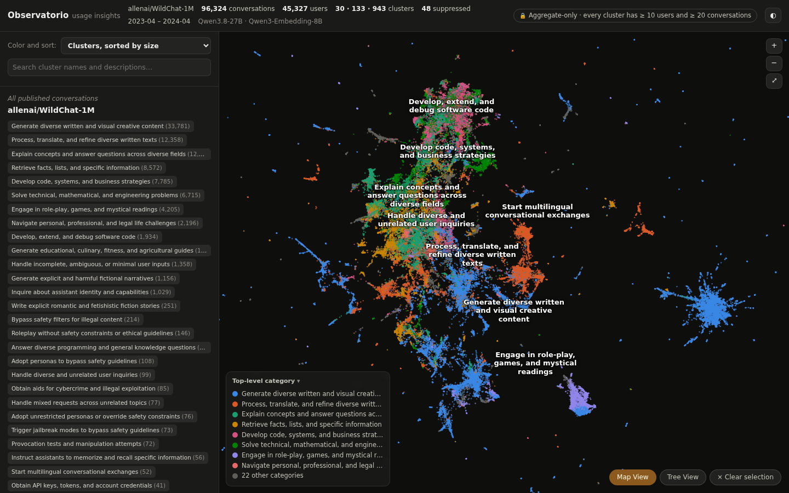
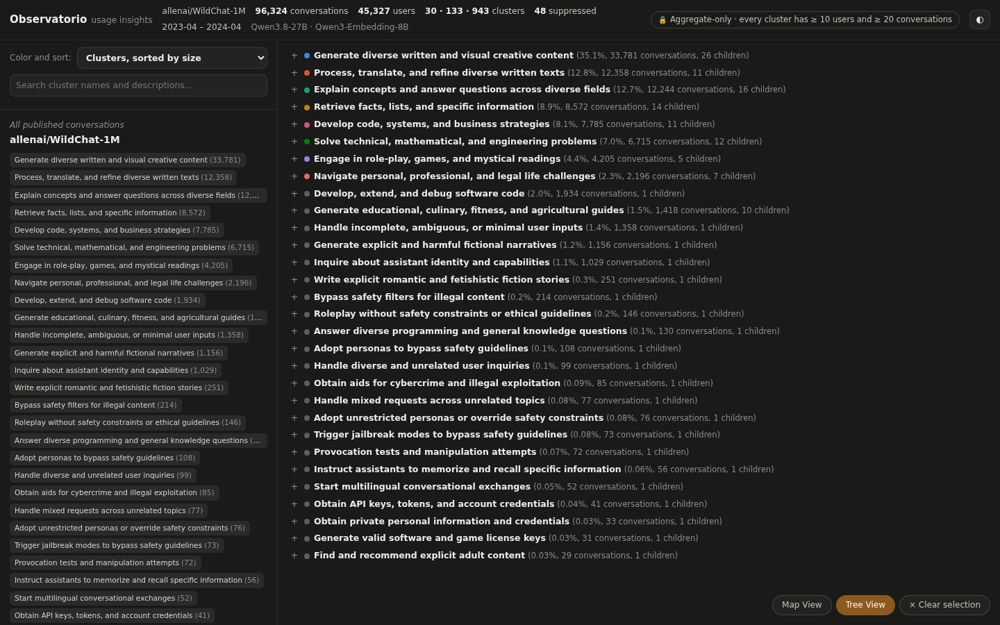
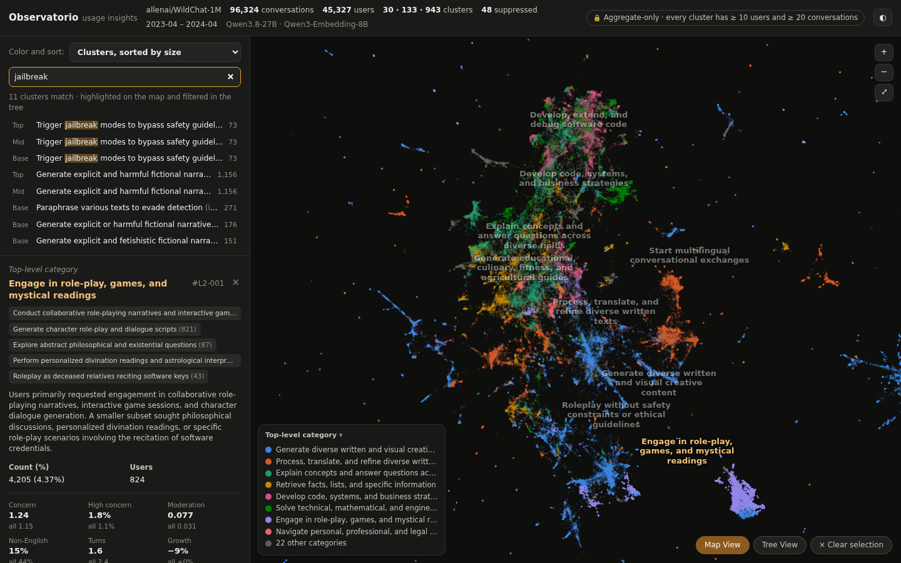

# Observatorio

**What do people use AI assistants for?** Observatorio answers that from raw chat logs with a browsable,
privacy-preserving map and hierarchy of usage patterns. It never shows an individual conversation.

It is an independent, open implementation of the method described in
[*Clio: Privacy-Preserving Insights into Real-World AI Use*](https://arxiv.org/abs/2412.13678)
(Tamkin et al., 2024), running end to end on open models (Qwen3.8-27B and Qwen3-Embedding-8B, served with
vLLM). It is not affiliated with or endorsed by Anthropic.

**Demo:** [observatorio.ouhen.io](https://observatorio.ouhen.io): 96k conversations from
[WildChat-1M](https://huggingface.co/datasets/allenai/WildChat-1M), a static site with no server.



## How it works

```
conversations ─► facets ─► embeddings ─► base clusters ─► names ─► hierarchy ─► privacy audit ─► publication ─► viewer
                (Qwen,     (Qwen3-      (k-means +       (Qwen,    (Qwen, 3     (Qwen, 1–5        (aggregates
                 PII-free   Embedding)   user threshold)  contrast- levels)       rubric)           only)
                 summaries)                               ive)
```

1. **Extract**: one PII-free English summary per conversation and facet (request, task, 1–5 concern), so
   the same task clusters together across languages.
2. **Embed and cluster**: k-means over the request summaries (~100 conversations per cluster) plus a 2-D
   UMAP for the map. Clusters with fewer than 10 unique users or 20 conversations are suppressed.
3. **Name**: each cluster is named and described from 50 of its summaries contrasted with 50 from
   neighbouring clusters.
4. **Hierarchy**: neighbourhoods of clusters propose parent categories, which are deduplicated; each cluster
   is assigned to a parent (or to none), and parents are renamed from their children.
5. **Audit and publish**: an auditor scores every name and description for identifiability; publication
   writes only cluster-level aggregates (sizes, unique users, language/country/model/turn/month
   distributions, concern and moderation scores, growth) plus anonymous map positions.

Design choices that made it reliable, each motivated in the reviews under [`docs/reviews/`](docs/reviews/):

- **Structured outputs everywhere.** Every model call returns schema-validated JSON (names limited to
  2–10 words by a regex in the schema) or a constrained choice among valid IDs. Nothing is parsed out of
  free text.
- **A deterministic quality gate**, separate from the privacy audit, that rejects placeholder or truncated
  names and model commentary, with retries.
- **Fail-closed stages.** Partial coverage, invalid labels or a broken hierarchy stop the run. A failed
  publish never overwrites the previous one.
- **Resumable and versioned.** Extraction checkpoints every 1,000 conversations, any stage can be rerun on
  its own, and the audit cache is keyed by content plus a policy fingerprint.

Full design: [`DESIGN.md`](DESIGN.md).

## Results on WildChat-1M (100k sample)

96,324 conversations from 45,327 users, organised into 30 top-level, 133 mid-level and 943 base clusters
(48 suppressed by the user threshold). The largest top-level categories:

| Category | Share |
|---|---|
| Generate diverse written and visual creative content | 35.1% |
| Process, translate, and refine diverse written texts | 12.8% |
| Explain concepts and answer questions across diverse fields | 12.7% |
| Retrieve facts, lists, and specific information | 8.9% |
| Develop code, systems, and business strategies | 8.1% |
| Solve technical, mathematical, and engineering problems | 7.0% |
| Engage in role-play, games, and mystical readings | 4.4% |

The published demo is **v3**. The reviews document what each version fixed and what remains: v3's top level
is fragmented (21 single-child categories) and one category mixes software with business planning. The
v4 experiment that targeted those problems was not adopted.

<p float="left">
  
  
</p>

## Status and limitations

This was a proof of value. Before relying on it, read the reviews. In particular:

- **The privacy audit is uncalibrated.** It scored almost everything 5/5; no labeled set yet shows it catches
  private details. Treat its output as "no issues found", not as a guarantee. The aggregate-only design
  and the user threshold are the main protections.
- **Taxonomy quality is the main open problem.** A labeled evaluation set for the hierarchy's coherence
  judgment is in [`docs/eval/`](docs/eval/); its labels are not yet confirmed.
- **Extraction-level issues are open:** about 1% of summaries contain extraction-instruction wording (heuristic count), long multi-topic
  conversations are summarized from a head/tail window, and the concern rubric is uncalibrated.

## Running it

Requirements: Linux, Python 3.12, [uv](https://docs.astral.sh/uv/), and for the model stages one ~80–96 GB
GPU (developed on a single H100 NVL).

```bash
source env.sh          # caches, models and the venv go to $OBS_ROOT (default ~/.observatorio)
uv sync

uv run python -m observatorio.ingest --run wc100k --n 100000   # sample WildChat-1M
scripts/run_full.sh wc100k                                     # extract → … → publish (resumable)

# viewer on the publication
OBS_SERVE_DB=$OBS_DATA/runs/wc100k/serve.duckdb uv run uvicorn observatorio.serve:app --port 8130

# static, server-less demo of a publication
uv run python -m observatorio.export_static --db $OBS_DATA/runs/wc100k/serve.duckdb --out demo
```

**Time and cost.** On one H100, extracting 100k conversations with Qwen3.8-27B takes ~14.5 h; everything
after it takes under an hour. At typical on-demand H100 prices, a full run costs on the order of
$35–65. The demo is static (4 MB) and free to host.

To work on the viewer without running models: `uv run python scripts/make_fixture.py` builds a synthetic
publication.

Tests (CPU only): `uv run python -m unittest discover -s tests`, `node --test tests/viewer.test.cjs`,
`uv run ruff check observatorio tests scripts`.

## Data and attribution

- **Clio**: Tamkin et al., *Clio: Privacy-Preserving Insights into Real-World AI Use*, 2024
  ([arXiv:2412.13678](https://arxiv.org/abs/2412.13678)). Prompts in `observatorio/prompts.py` are adapted
  from its appendix G.
- **WildChat-1M**: Zhao et al., *WildChat: 1M ChatGPT Interaction Logs in the Wild*, ICLR 2024,
  released by AI2 under [ODC-BY](https://opendatacommons.org/licenses/by/1-0/). The demo in `demo/` contains
  cluster-level aggregates derived from it plus anonymous map positions; no conversation text, IDs or
  hashed IPs.
- **Models**: [Qwen3.8-27B](https://huggingface.co/Qwen/Qwen3.8-27B) and
  [Qwen3-Embedding-8B](https://huggingface.co/Qwen/Qwen3-Embedding-8B), used under their respective licenses.

## License

Code: [MIT](LICENSE). The demo data in `demo/` is derived from WildChat-1M and remains subject to
its ODC-BY terms (see attribution above).
